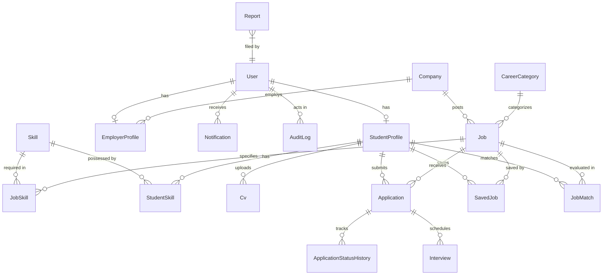

# Recruitment and Notification Data Design — CM-082

This document specifies the database models, entity relationships, integrity constraints, and indexing strategy for the Recruitment and Notification domains of CareerMatch AI.

Parent Work Package: **[CM-008] Design the core PostgreSQL schema with Prisma**  
Assigned Owner: **@NguyenDucHoangHuy**  
Reviewed against: `apps/api/prisma/schema.prisma` (PostgreSQL 17 + `pgvector` + Prisma 7)  
Companion Specification: [Recruitment State Transitions & Events (CM-081)](recruitment-state-transitions.md)

---

## 1. Domain Entity Relationship Diagram (ERD)

---

## 2. Model Definitions & Physical Mapping

All primary keys use UUID v4 values. Foreign keys enforce referential integrity with explicit cascade or restrict constraints.

### 2.1. Company & Employer Domain

#### `Company`
Represents an employer organization registered on the platform.
* `id` (`UUID`): Primary key.
* `name` (`TEXT`): Official business / trading name.
* `description` (`TEXT`, nullable): Company overview and mission.
* `website` (`TEXT`, nullable): Corporate URL.
* `location` (`TEXT`, nullable): Headquarter city / province.
* `taxCode` (`TEXT`, nullable, unique): Business registration number / tax identification.
* `verificationStatus` (`VerificationStatus`): Default `PENDING`. Values: `PENDING`, `VERIFIED`, `REJECTED`.
* `verifiedAt` (`TIMESTAMP`, nullable): Timestamp when Admin approved verification.
* `createdAt`, `updatedAt` (`TIMESTAMP`): Audit timestamps.

#### `EmployerProfile`
Represents the recruiter / hiring manager persona linked to a base `User`.
* `id` (`UUID`): Primary key.
* `userId` (`UUID`, unique): One-to-one foreign key to `User(id)`, `onDelete: Cascade`.
* `fullName` (`TEXT`): Recruiter's full display name.
* `position` (`TEXT`, nullable): Professional title (e.g., "HR Director").
* `companyId` (`UUID`, nullable): Foreign key to `Company(id)`, `onDelete: SetNull`. Allows an employer account to exist prior to company affiliation.

---

### 2.2. Job Postings & Categorization Domain

#### `CareerCategory`
Taxonomy grouping jobs into distinct industry / technical tracks.
* `id` (`UUID`): Primary key.
* `name` (`TEXT`, unique): E.g., "Software Development", "Cloud & DevOps".
* `description` (`TEXT`, nullable): Category scope.

#### `Job`
Core opportunity published by verified companies.
* `id` (`UUID`): Primary key.
* `companyId` (`UUID`): Foreign key to `Company(id)`, `onDelete: Restrict`.
* `categoryId` (`UUID`, nullable): Foreign key to `CareerCategory(id)`, `onDelete: SetNull`.
* `title` (`TEXT`): Job title (e.g., "Backend Developer Intern").
* `description` (`TEXT`): Detailed responsibilities, expectations, and benefits.
* `location` (`TEXT`, nullable): Job location (e.g., "TP. Hồ Chí Minh").
* `workMode` (`TEXT`, nullable): "On-site", "Hybrid", "Remote".
* `status` (`JobStatus`): Default `DRAFT`. Values: `DRAFT`, `PENDING_APPROVAL`, `PUBLISHED`, `REJECTED`, `CLOSED`.
* `publishedAt` (`TIMESTAMP`, nullable): Set when approved by Admin.
* `createdAt`, `updatedAt` (`TIMESTAMP`): Audit timestamps.
* **Indexes:**
  - `@@index([status, publishedAt])`: Optimizes public job search (`WHERE status = 'PUBLISHED' ORDER BY publishedAt DESC`).
  - `@@index([companyId, status])`: Optimizes employer portal queries for their active and draft postings.

#### `JobSkill`
Many-to-many relationship defining required vs preferred skills for a job.
* `jobId` (`UUID`): Foreign key to `Job(id)`, `onDelete: Cascade`.
* `skillId` (`UUID`): Foreign key to `Skill(id)`, `onDelete: Restrict`.
* `required` (`BOOLEAN`): Default `true`. `true` denotes mandatory skill; `false` denotes bonus / preferred skill.
* `weight` (`FLOAT`): Default `1.0`. Multiplier for AI matching algorithms.
* **Primary Key:** Composite `@@id([jobId, skillId])`.

---

### 2.3. Application & Interview Lifecycle Domain

#### `Application`
Represents a student's formal submission to a specific job.
* `id` (`UUID`): Primary key.
* `studentId` (`UUID`): Foreign key to `StudentProfile(id)`, `onDelete: Restrict`.
* `jobId` (`UUID`): Foreign key to `Job(id)`, `onDelete: Restrict`.
* `status` (`ApplicationStatus`): Default `SUBMITTED`. Values: `SUBMITTED`, `REVIEWING`, `SHORTLISTED`, `INTERVIEW`, `ACCEPTED`, `REJECTED`, `WITHDRAWN`.
* `coverLetter` (`TEXT`, nullable): Optional message from applicant.
* `submittedAt`, `updatedAt` (`TIMESTAMP`): Timestamps.
* **Constraints:**
  - `@@unique([studentId, jobId])`: Strictly guarantees one active application per student per job.
  - `@@index([jobId, status])`: Optimizes recruiter applicant review and status filtering.

#### `ApplicationStatusHistory`
Immutable audit log tracking every status transition.
* `id` (`UUID`): Primary key.
* `applicationId` (`UUID`): Foreign key to `Application(id)`, `onDelete: Cascade`.
* `fromStatus` (`ApplicationStatus`, nullable): Previous status (`null` on initial submission).
* `toStatus` (`ApplicationStatus`): New status.
* `reason` (`TEXT`, nullable): Human explanation (mandatory for rejections/cancellations).
* `changedById` (`UUID`): User ID of the actor executing the change.
* `createdAt` (`TIMESTAMP`): Exact mutation time.
* **Invariant:** Append-only table. Updates and deletes are prohibited.

#### `Interview`
Scheduled discussion session linked to an application.
* `id` (`UUID`): Primary key.
* `applicationId` (`UUID`): Foreign key to `Application(id)`, `onDelete: Cascade`.
* `scheduledAt` (`TIMESTAMP`): Proposed meeting time (must be in future).
* `durationMin` (`INT`): Interview duration in minutes (range: 15–180).
* `meetingUrl` (`TEXT`, nullable): Virtual meeting link (Google Meet, Zoom).
* `location` (`TEXT`, nullable): Physical meeting venue.
* `status` (`InterviewStatus`): Default `PROPOSED`. Values: `PROPOSED`, `ACCEPTED`, `DECLINED`, `COMPLETED`, `CANCELLED`.
* `notes` (`TEXT`, nullable): Recruiter notes or feedback.
* `createdAt`, `updatedAt` (`TIMESTAMP`): Audit timestamps.

---

### 2.4. Matching & Bookmarks Domain

#### `JobMatch`
Cached explainable AI matching result comparing a student profile to a job.
* `id` (`UUID`): Primary key.
* `studentId` (`UUID`): Foreign key to `StudentProfile(id)`, `onDelete: Cascade`.
* `jobId` (`UUID`): Foreign key to `Job(id)`, `onDelete: Cascade`.
* `score` (`FLOAT`): Overall score (0.00 – 100.00).
* `skillScore` (`FLOAT`): Rule-based overlap score.
* `semanticScore` (`FLOAT`, nullable): Vector embedding similarity score.
* `matchedSkills` (`JSON`): List of normalized skills satisfied by applicant.
* `missingSkills` (`JSON`): List of mandatory skills missing (Skill Gap).
* `explanation` (`TEXT`): Human-readable natural language summary.
* `engineVersion` (`TEXT`): Matching algorithm version (e.g. `rule-based-v1`).
* `createdAt` (`TIMESTAMP`): Timestamp of calculation.
* **Constraints:**
  - `@@unique([studentId, jobId, engineVersion])`: One score per algorithm version.
  - `@@index([jobId, score])`: Supports employer candidate ranking.
  - `@@index([studentId, score])`: Supports student job recommendation feed.

#### `SavedJob`
Student bookmarks for later application.
* `studentId` (`UUID`), `jobId` (`UUID`): Composite primary key `@@id([studentId, jobId])`. Cascades on deletion of student or job.

---

### 2.5. Notifications & Platform Audit Domain

#### `Notification`
Durable event record delivered to individual users.
* `id` (`UUID`): Primary key.
* `userId` (`UUID`): Foreign key to `User(id)`, `onDelete: Cascade`.
* `type` (`NotificationType`): 16 discrete event types.
* `title` (`TEXT`), `body` (`TEXT`): User-facing message.
* `data` (`JSON`, nullable): Deep-linking context (`jobId`, `applicationId`, `interviewId`).
* `readAt` (`TIMESTAMP`, nullable): Timestamp when viewed by user.
* `createdAt` (`TIMESTAMP`): Dispatch timestamp.
* **Indexes:**
  - `@@index([userId, readAt, createdAt])`: Efficiently queries unread counts (`WHERE userId = ? AND readAt IS NULL`) and inbox paging.

#### `Report`
User reporting mechanism for moderation.
* `id` (`UUID`): Primary key.
* `reporterId` (`UUID`): Foreign key to `User(id)`.
* `targetType` (`TEXT`): "JOB", "COMPANY", "PROFILE".
* `targetId` (`TEXT`): UUID of reported entity.
* `reason` (`TEXT`): User explanation.
* `status` (`TEXT`): Default `"OPEN"`. Values: `"OPEN"`, `"RESOLVED"`, `"DISMISSED"`.
* `createdAt`, `resolvedAt` (`TIMESTAMP`): Resolution timestamps.

#### `AuditLog`
Compliance logging for security and administrative actions.
* `id` (`UUID`): Primary key.
* `actorId` (`UUID`, nullable): User performing the action.
* `action` (`TEXT`): E.g., `COMPANY_VERIFIED`, `JOB_APPROVED`, `USER_SUSPENDED`.
* `entity` (`TEXT`): Entity type affected.
* `entityId` (`TEXT`, nullable): Target ID.
* `metadata` (`JSON`, nullable): Contextual details (IP, user agent, previous state).
* `createdAt` (`TIMESTAMP`): Log time.
* **Indexes:**
  - `@@index([entity, entityId])`: Entity audit history lookups.
  - `@@index([actorId, createdAt])`: Actor activity history lookups.

---

## 3. Indexing Strategy & Performance Justifications

| Index Name / Fields | Target Query Pattern | Performance Benefit |
| :--- | :--- | :--- |
| `Job([status, publishedAt])` | Public job catalog browsing: `WHERE status = 'PUBLISHED' ORDER BY publishedAt DESC LIMIT 20` | Avoids sequential table scans; satisfies query entirely from B-Tree index. |
| `Job([companyId, status])` | Employer dashboard: `WHERE companyId = ? AND status IN ('DRAFT', 'PUBLISHED')` | Fast filtering by employer organization. |
| `Application([jobId, status])` | Recruiter applicant tracking: `WHERE jobId = ? AND status = 'SHORTLISTED'` | Instant candidate filtering without scanning unrelated jobs. |
| `JobMatch([jobId, score])` | Recruiter candidate ranking: `WHERE jobId = ? ORDER BY score DESC` | Instant top-matched candidates ranking. |
| `JobMatch([studentId, score])` | Student personalized feed: `WHERE studentId = ? ORDER BY score DESC` | Instant recommendations rendering. |
| `Notification([userId, readAt, createdAt])`| Notification badge: `COUNT(*) WHERE userId = ? AND readAt IS NULL` and inbox pagination | Combined index eliminates sorting cost and speeds up badge query to $< 1\text{ms}$. |
| `AuditLog([entity, entityId])` | Admin investigating entity history | Enables instant timeline reconstruction for any reported entity. |

---

## 4. Referential Integrity & Cascade Matrix

| Parent Table | Child Table | Foreign Key Field | Cascade Rule (`onDelete`) | Architectural Justification |
| :--- | :--- | :--- | :--- | :--- |
| `User` | `StudentProfile` | `userId` | `Cascade` | Deleting a user account cleans their personal student profile. |
| `User` | `EmployerProfile` | `userId` | `Cascade` | Deleting an employer user cleans their recruiter profile. |
| `Company` | `EmployerProfile` | `companyId` | `SetNull` | Deleting or restructuring a company unlinks recruiters without deleting their accounts. |
| `Company` | `Job` | `companyId` | `Restrict` | Prevents deleting a company while active or archived jobs still reference it. |
| `Job` | `JobSkill` | `jobId` | `Cascade` | Removing a job draft cleans its skill requirements automatically. |
| `Job` | `Application` | `jobId` | `Restrict` | **Critical:** Jobs with submitted applications cannot be hard-deleted (they must transition to `CLOSED`). |
| `Application` | `ApplicationStatusHistory` | `applicationId` | `Cascade` | Application lifecycle history is tied directly to the parent application. |
| `Application` | `Interview` | `applicationId` | `Cascade` | Deleting an application cleans associated interview scheduling records. |
| `Skill` | `JobSkill` | `skillId` | `Restrict` | Catalog skills cannot be deleted if active jobs require them. |
