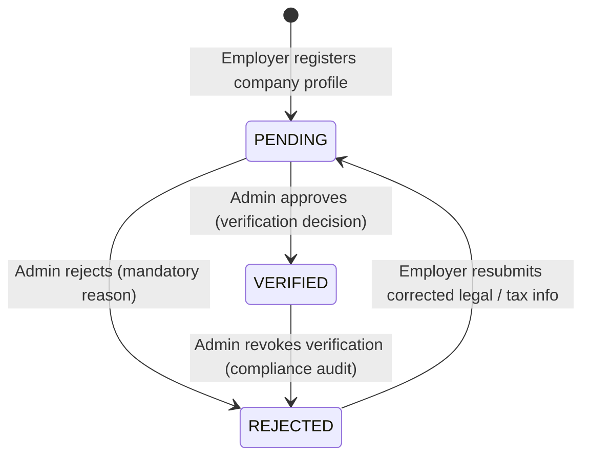
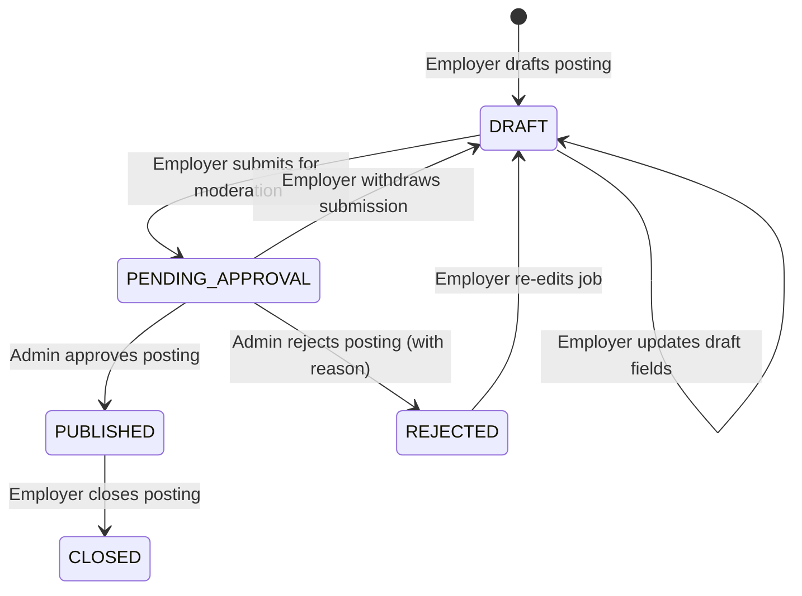
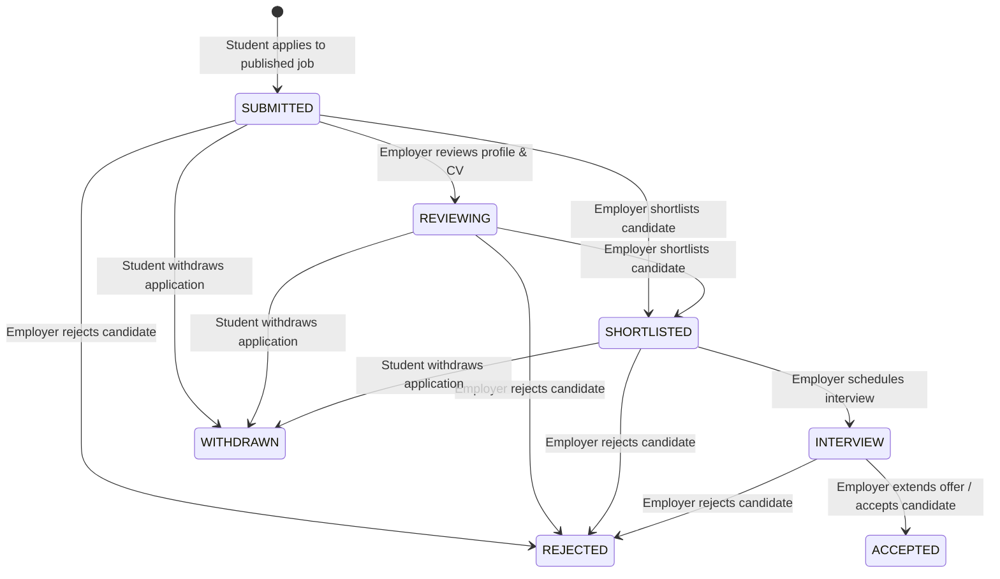
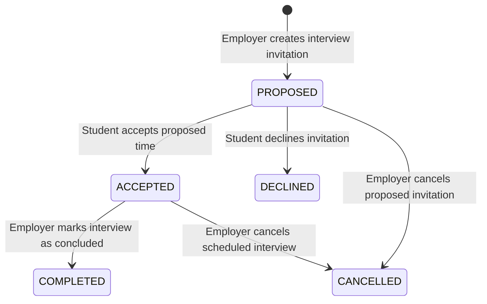

# Recruitment State Transitions and Event Matrix — CM-081

This document specifies the core recruitment workflows, state machines, business rules, failure cases, and event-driven notification matrix for CareerMatch AI.

Parent Work Package: **[CM-004] Specify use cases and recruitment workflows**  
Related Issues: **CM-081**, **CM-082**, **CM-084**, **CM-085**, **CM-088**, **CM-090**, **CM-091**, **CM-092**, **CM-093**

---

## 1. Architectural Principles

1. **Human-Controlled Hiring Decisions:**
   - AI provides match scores, extracted skills, and skill gap analyses as advisory signals only.
   - Shortlisting, interview invitations, and final acceptance/rejection decisions are executed exclusively by authorized human Employers or Admins.
   - The system strictly forbids automated AI-driven hiring or rejection.

2. **Immutable Audit Trail:**
   - Every state transition in the recruitment lifecycle is persisted with timestamps, actor IDs, previous states, and optional reasons in `ApplicationStatusHistory` and `AuditLog`.
   - Direct database status updates bypassing domain validation are prohibited.

3. **Event-Driven Notification Delivery:**
   - State mutations emit synchronous domain events within database transactions.
   - Notifications are persisted to the database (`Notification` table) and dispatched in real time via Socket.IO to isolated user channels (`user:<userId>`).

---

## 2. State Machines

### 2.1. Company Verification State Machine

Controls whether an Employer organization is trusted to publish job postings to students.



| Transition | Permitted Actor | Preconditions & Business Rules | Emitted Event |
| :--- | :--- | :--- | :--- |
| `[*] -> PENDING` | Employer | Organization profile created with non-empty `name` and valid `taxCode`. | `COMPANY_VERIFICATION_REQUIRED` (to Admins) |
| `PENDING -> VERIFIED` | Admin | Legal and tax information verified. Sets `verifiedAt = now()`. | `COMPANY_VERIFIED` (to Employer) |
| `PENDING -> REJECTED` | Admin | Rejection reason must be provided (min 10 characters). | `COMPANY_REJECTED` (to Employer) |
| `REJECTED -> PENDING` | Employer | Profile updated with new documentation/tax code. | `COMPANY_VERIFICATION_REQUIRED` (to Admins) |
| `VERIFIED -> REJECTED` | Admin | Compliance revocation. Any active jobs remain open or are auto-closed per admin discretion. | `COMPANY_REJECTED` (to Employer) |

---

### 2.2. Job Posting State Machine

Governs the publication lifecycle of job opportunities created by employers.



| Transition | Permitted Actor | Preconditions & Validation Rules | Emitted Event |
| :--- | :--- | :--- | :--- |
| `[*] -> DRAFT` | Employer | Employer belongs to a company. Basic title and description. | *None* |
| `DRAFT -> PENDING_APPROVAL` | Employer | Company must be `VERIFIED`. Required skills, category, and location specified. | `JOB_APPROVAL_REQUIRED` (to Admins) |
| `PENDING_APPROVAL -> PUBLISHED` | Admin | Content complies with community guidelines. Sets `publishedAt = now()`. | `JOB_APPROVED` (to Employer) |
| `PENDING_APPROVAL -> REJECTED` | Admin | Reason provided (e.g., spam, deceptive description). | `JOB_REJECTED` (to Employer) |
| `REJECTED -> DRAFT` | Employer | Reverts to draft for corrective editing. | *None* |
| `PUBLISHED -> CLOSED` | Employer / Admin | Job reaches hiring capacity or expiry. New applications are rejected immediately. | *None* |

---

### 2.3. Application Lifecycle State Machine

Tracks a student's candidacy from submission through evaluation to terminal decision.



#### Application States Description:
* **`SUBMITTED`:** Student submitted their profile and CV. Awaiting employer review.
* **`REVIEWING`:** Employer has opened and reviewed the application profile/CV.
* **`SHORTLISTED`:** Candidate profile meets requirements and is flagged for interview consideration.
* **`INTERVIEW`:** Candidate has at least one active interview scheduled or proposed.
* **`ACCEPTED` (Terminal):** Employer officially accepts the candidate for the role.
* **`REJECTED` (Terminal):** Employer declines the candidate.
* **`WITHDRAWN` (Terminal):** Student voluntarily withdraws their application before a final decision.

#### Transition Validation Rules:

| From Status | Allowed To Status | Permitted Actor | Invariants & Failure Conditions |
| :--- | :--- | :--- | :--- |
| `[*] (New)` | `SUBMITTED` | Student | Job must be in `PUBLISHED` status. Student must have an active profile. Unique constraint `[studentId, jobId]` prevents duplicate applications (409 Conflict). |
| `SUBMITTED` | `REVIEWING` | Employer | Employer must own the company that posted the job. |
| `SUBMITTED` / `REVIEWING` | `SHORTLISTED` | Employer | Employer owns the job. |
| `SHORTLISTED` | `INTERVIEW` | Employer | Triggered automatically when an interview invitation is created. |
| `INTERVIEW` | `ACCEPTED` | Employer | Human-controlled decision. Terminal state. Any remaining pending interviews are marked completed. |
| `SUBMITTED` / `REVIEWING` / `SHORTLISTED` / `INTERVIEW` | `REJECTED` | Employer | Human-controlled decision. Terminal state. Optional rejection feedback note. |
| `SUBMITTED` / `REVIEWING` / `SHORTLISTED` | `WITHDRAWN` | Student | Student can only withdraw their own application. Cannot withdraw if already in terminal state (`ACCEPTED`, `REJECTED`, or `WITHDRAWN`) or while in `INTERVIEW` stage without cancelling the interview first. |

---

### 2.4. Interview Lifecycle State Machine

Controls scheduling, confirmation, and outcome of interviews between student and employer.



| Transition | Permitted Actor | Preconditions & Validation Rules | Emitted Event |
| :--- | :--- | :--- | :--- |
| `[*] -> PROPOSED` | Employer | Application must be in `SHORTLISTED` or `INTERVIEW` status. `scheduledAt` must be $\ge 1\text{ hour}$ in the future. `durationMin` between 15 and 180 minutes. Meeting URL or physical location required. | `INTERVIEW_INVITATION` (to Student) |
| `PROPOSED -> ACCEPTED` | Student | Only the candidate owning the application can respond. | `INTERVIEW_CONFIRMED` (to Employer) |
| `PROPOSED -> DECLINED` | Student | Only candidate can decline. Optional reason note. | `INTERVIEW_DECLINED` (to Employer) |
| `PROPOSED -> CANCELLED` | Employer | Cancellation reason required. | `INTERVIEW_CANCELLED` (to Student) |
| `ACCEPTED -> COMPLETED` | Employer | Interview took place. | *None* |
| `ACCEPTED -> CANCELLED` | Employer | Cancellation reason required. | `INTERVIEW_CANCELLED` (to Student) |

---

## 3. Notification Matrix

The system specifies a deterministic event-to-notification mapping. Every event writes a durable record to `Notification` and broadcasts via WebSocket.

| Event Type (`NotificationType`) | Triggering Action | Recipient Role & Target | Notification Title | Body Template | Payload Data (`data`) |
| :--- | :--- | :--- | :--- | :--- | :--- |
| `CV_ANALYSIS_COMPLETED` | AI service finishes CV parsing | Student (`userId`) | CV Analysis Complete | Your CV has been analyzed and skills have been extracted. | `{ cvId, skillCount }` |
| `JOB_RECOMMENDATION` | AI matching calculates score $\ge 80\%$ | Student (`userId`) | New Job Recommendation | We found a job that matches your profile: {jobTitle}. | `{ jobId, matchScore }` |
| `NEW_APPLICATION` | Student submits application | Employer (`employer.userId`) | New Application Received | {studentName} submitted an application for {jobTitle}. | `{ jobId, applicationId, studentId }` |
| `APPLICATION_WITHDRAWN` | Student withdraws application | Employer (`employer.userId`) | Application Withdrawn | {studentName} has withdrawn their application for {jobTitle}. | `{ jobId, applicationId }` |
| `APPLICATION_SHORTLISTED` | Employer shortlists candidate | Student (`userId`) | Application Shortlisted | {companyName} has shortlisted your application for {jobTitle}. | `{ jobId, applicationId }` |
| `INTERVIEW_INVITATION` | Employer proposes interview | Student (`userId`) | Interview Invitation | {companyName} invited you to an interview for {jobTitle}. | `{ jobId, applicationId, interviewId, scheduledAt }` |
| `INTERVIEW_CONFIRMED` | Student accepts interview | Employer (`employer.userId`) | Interview Confirmed | {studentName} confirmed the interview for {jobTitle}. | `{ interviewId, applicationId }` |
| `INTERVIEW_DECLINED` | Student declines interview | Employer (`employer.userId`) | Interview Declined | {studentName} declined the interview invitation for {jobTitle}. | `{ interviewId, applicationId, reason }` |
| `APPLICATION_ACCEPTED` | Employer accepts candidate | Student (`userId`) | Congratulations! Application Accepted | {companyName} has accepted your application for {jobTitle}. | `{ jobId, applicationId }` |
| `APPLICATION_REJECTED` | Employer rejects candidate | Student (`userId`) | Application Update | Your application for {jobTitle} at {companyName} was not selected. | `{ jobId, applicationId }` |
| `COMPANY_VERIFICATION_REQUIRED`| Employer registers/updates company | Admin (`all active admins`) | Company Verification Needed | {companyName} has requested verification. | `{ companyId, taxCode }` |
| `COMPANY_VERIFIED` | Admin approves company | Employer (`employer.userId`) | Company Verified | Your company {companyName} has been verified successfully. | `{ companyId }` |
| `JOB_APPROVAL_REQUIRED` | Employer submits job | Admin (`all active admins`) | Job Approval Required | {companyName} submitted {jobTitle} for approval. | `{ jobId, companyId }` |
| `JOB_APPROVED` | Admin approves job | Employer (`employer.userId`) | Job Approved | Your job posting {jobTitle} is now published. | `{ jobId }` |
| `JOB_REJECTED` | Admin rejects job | Employer (`employer.userId`) | Job Posting Needs Revision | Your job posting {jobTitle} was not approved: {reason}. | `{ jobId, reason }` |
| `NEW_REPORT` | User reports job or profile | Admin (`all active admins`) | New User Report | A new report has been submitted regarding {targetType}. | `{ reportId, targetType, targetId }` |

---

## 4. Realtime Socket.IO Specifications

- **Namespace:** `/notifications`
- **Authentication:** Socket handshake query contains `token` (JWT Access Token). Connection is rejected with `401 Unauthorized` if invalid, expired, or user is suspended.
- **Room Isolation:** Each socket automatically joins room `user:<userId>`. Broadcasts across different users are strictly disallowed.
- **Client Event Emitted:**
  ```json
  // Event Name: "notification:received"
  {
    "id": "uuid-string",
    "type": "INTERVIEW_INVITATION",
    "title": "Interview Invitation",
    "body": "TechCorp Solutions invited you to an interview for Backend Developer Intern.",
    "data": {
      "jobId": "job-uuid",
      "applicationId": "app-uuid",
      "interviewId": "interview-uuid",
      "scheduledAt": "2026-11-21T07:00:00.000Z"
    },
    "createdAt": "2026-11-18T08:00:00.000Z"
  }
  ```

---

## 5. Security & Ownership Rules

1. **Job Application Ownership:**
   - A student can only view and withdraw applications where `application.studentId == currentStudent.id`.
   - An employer can only view and mutate applications where `application.job.companyId == currentEmployer.companyId`.
2. **Interview Ownership:**
   - Only the employer owning the job can schedule or cancel interviews.
   - Only the student associated with the application can accept or decline the interview.
3. **Data Integrity Invariants:**
   - `ApplicationStatusHistory` is append-only. No records in this table may be edited or deleted.
   - Deleting a `Job` cascades to `JobSkill`, `SavedJob`, and `JobMatch`, but jobs with existing `Application` records cannot be hard deleted (they must be set to `CLOSED`).

---

## 6. Stable Error Envelopes & Business Codes

When a state transition is rejected, the API returns a structured HTTP 400 or 409 response:

```json
{
  "statusCode": 409,
  "code": "INVALID_STATE_TRANSITION",
  "message": "Cannot transition application from REJECTED to INTERVIEW.",
  "details": {
    "currentStatus": "REJECTED",
    "targetStatus": "INTERVIEW",
    "allowedTransitions": []
  }
}
```

Standard domain error codes for recruitment workflows:
- `COMPANY_NOT_VERIFIED`: Attempting to submit a job while company is `PENDING` or `REJECTED`.
- `JOB_NOT_ACCEPTING_APPLICATIONS`: Attempting to apply to a job that is `DRAFT`, `PENDING_APPROVAL`, `REJECTED`, or `CLOSED`.
- `DUPLICATE_APPLICATION`: Student has already applied for this job (`[studentId, jobId]` conflict).
- `INVALID_STATE_TRANSITION`: Target state is not reachable from current state.
- `APPLICATION_TERMINAL_STATE`: Modifying an application in `ACCEPTED`, `REJECTED`, or `WITHDRAWN` status.
- `INVALID_INTERVIEW_SCHEDULE`: Interview scheduled in the past or duration out of range (15–180m).
